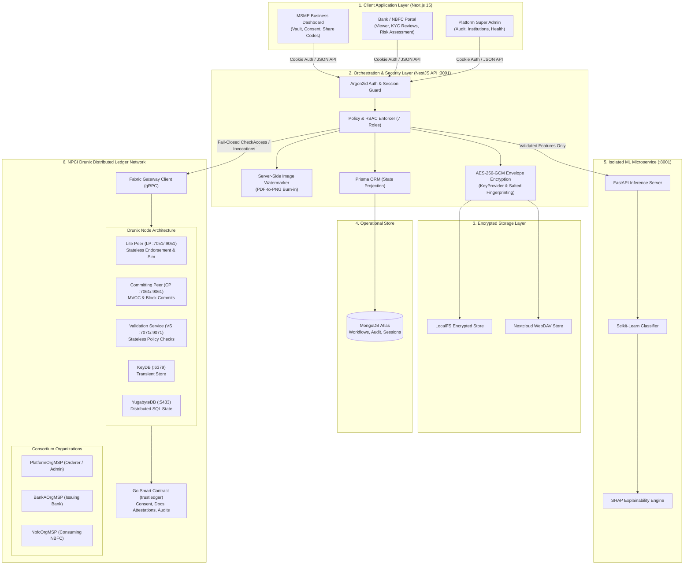
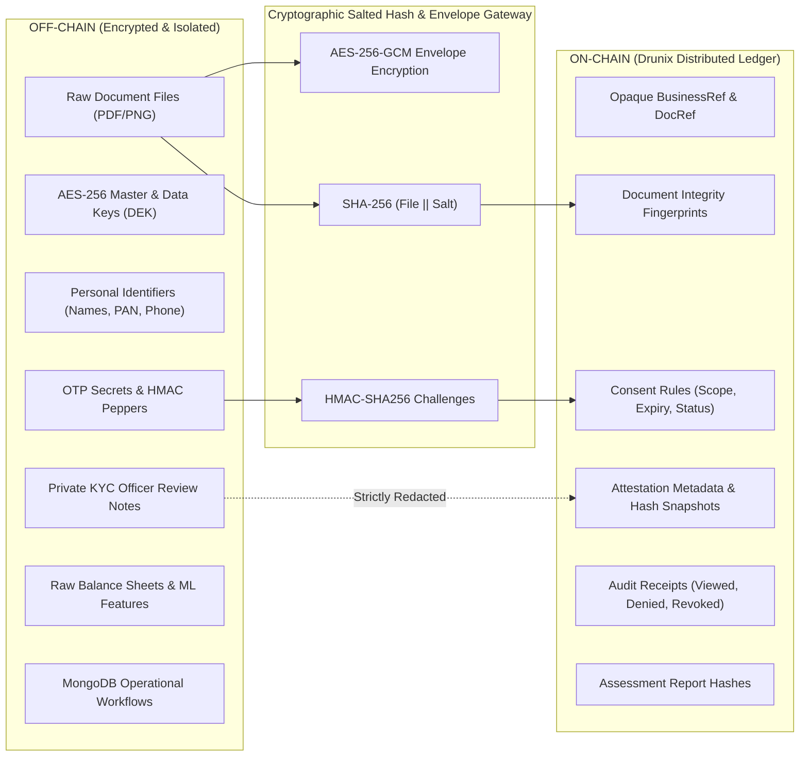
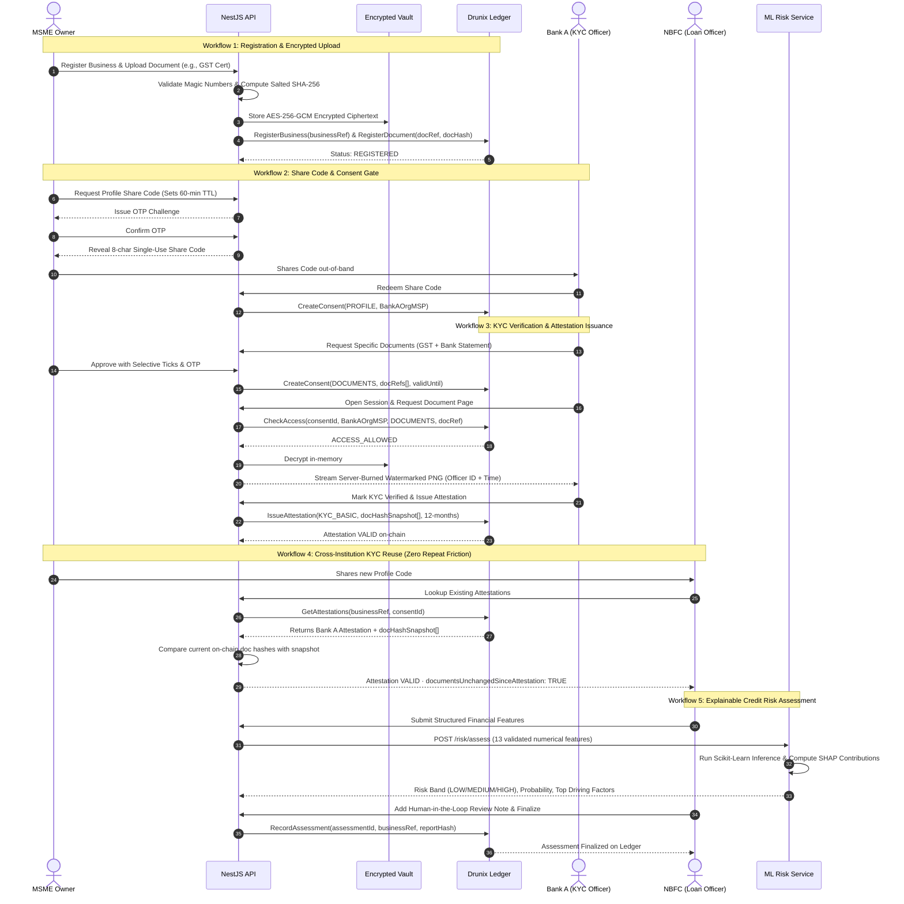

# TrustLedger — Consent-Based MSME Verification & Credit Risk Assessment on Drunix

---

## **[ 🚨🚨 CLICK HERE TO VIEW OFFICIAL HACKATHON PITCH DECK (GOOGLE DRIVE) 🚨🚨](https://drive.google.com/file/d/1sq4rMr6bEScnJLihrq1XGkjSnA7Jq_uD/view?usp=sharing)**

> **NPCI × Drunix Hackathon · Track: Financial Inclusion**  
> *Tagline: Verify with trust. Share with consent. Assess risk with evidence.*

[](https://drive.google.com/file/d/1sq4rMr6bEScnJLihrq1XGkjSnA7Jq_uD/view?usp=sharing)

[](https://www.typescriptlang.org/)
[](https://nextjs.org/)
[](https://nestjs.com/)
[](https://github.com/npci-oss)
[](https://fastapi.tiangolo.com/)
[](https://www.mongodb.com/)
[](LICENSE)

---

## Table of Contents
1. [The Problem: India's MSME Credit & KYC Gap](#1-the-problem-indias-msme-credit--kyc-gap)
2. [The Solution: TrustLedger on NPCI Drunix](#2-the-solution-trustledger-on-npci-drunix)
3. [Competitive Landscape: How TrustLedger Differs & Excels](#3-competitive-landscape-how-trustledger-differs--excels)
4. [System Architecture](#4-system-architecture)
5. [NPCI Drunix DLT Integration: How & Where It Is Used](#5-npci-drunix-dlt-integration-how--where-it-is-used)
6. [The Privacy Boundary: What is On-Chain vs. Off-Chain](#6-the-privacy-boundary-what-is-on-chain-vs-off-chain)
7. [End-to-End Product Walkthrough (The 5 Core Workflows)](#7-end-to-end-product-walkthrough-the-5-core-workflows)
8. [Explainable Credit Risk Assessment (ML Microservice)](#8-explainable-credit-risk-assessment-ml-microservice)
9. [Security, Invariants & Cryptographic Defense](#9-security-invariants--cryptographic-defense)
10. [Technology Stack & Repository Layout](#10-technology-stack--repository-layout)
11. [Local Development & Setup Guide](#11-local-development--setup-guide)
12. [Honesty & Architecture Disclosures (H-1 to H-8)](#12-honesty--architecture-disclosures-h-1-to-h-8)

---

## 1. The Problem: India's MSME Credit & KYC Gap

India's 63+ million Micro, Small, and Medium Enterprises (MSMEs) form the backbone of the economy, yet face an estimated **₹25+ lakh crore ($300B+) credit gap**. When an MSME applies for working capital or invoice financing across multiple banks or Non-Banking Financial Companies (NBFCs), they encounter severe systemic hurdles:

```
┌────────────────────────────────────────────────────────────────────────┐
│                      Traditional MSME Lending Friction                 │
└────────────────────────────────────────────────────────────────────────┘
  MSME                               Bank A                            NBFC B
   │                                   │                                 │
   │─── Unencrypted PDFs via email ───>│ (Manual KYC Review: 7-14 Days)  │
   │    (Bank statements, GST, PAN)    │ Store on unmonitored drives     │
   │                                   │                                 │
   │─── Repeat identical process ───────────────────────────────────────>│ (Manual KYC: Another 14 Days)
   │    Zero cross-bank verification                                     │ Duplicated effort, high OPEX
   │                                                                     │
   ▼                                                                     ▼
• Massive Data Sprawl             • Risk of Stale / Tampered Docs   • Loan Rejection Due to Lack
• MSME has zero revocation power  • Zero cryptographic provenance   of Standardized Evidence
```

1. **Repetitive KYC Friction:** Each lending institution restarts identity and business verification from scratch. There is no trust-minimized mechanism for Bank B to reuse Bank A's completed KYC without leaking proprietary customer records.
2. **Uncontrolled Document Sprawl:** Sensitive GST declarations, balance sheets, and tax filings are emailed as raw PDFs. These files remain indefinitely on disparate bank storage servers without customer consent controls or expiration.
3. **Absence of Tamper-Evident Integrity:** If a business amends its filings or provides modified bank statements, subsequent lenders cannot verify whether the documents match the exact evidence verified by earlier institutions.
4. **Subjective & Slow Underwriting:** Loan decisions frequently rely on manual heuristic analysis lacking objective, explainable credit-risk scoring.

---

## 2. The Solution: TrustLedger on NPCI Drunix

**TrustLedger** solves these challenges by establishing a **shared, decentralized verification and consent layer powered by NPCI Drunix**, coupled with an off-chain customer-controlled encrypted vault and an explainable ML credit-risk microservice.

- **Zero-Knowledge KYC Attestations:** When Bank A verifies an MSME, it commits a cryptographic attestation to Drunix chaincode along with a snapshot of verified document hashes. NBFC B can instantly query and reuse this attestation on-chain without Bank A ever sharing its private review notes or customer lists.
- **Fail-Closed, Ledger-First Access Gates:** Document bytes are **never released** until the backend verifies an active, unexpired, and unrevoked consent record on the Drunix ledger. If the ledger is unreachable, the system fails closed.
- **Granular, Time-Limited MSME Consent:** The MSME owner maintains absolute sovereignty. They selectively approve individual files, enforce expiration windows (e.g., 60 minutes), block raw file downloads, and can revoke consent at any moment.
- **Explainable AI for Credit Inclusion:** Structured financial metrics are evaluated by an isolated ML engine producing interpretable risk bands and SHAP factor contributions. No documents or PII are ever exposed to the ML model.

---

## 3. Competitive Landscape: How TrustLedger Differs & Excels

While the Indian digital public infrastructure (DPI) ecosystem has pioneered retail payments (UPI) and structured financial telemetry (Account Aggregator), critical voids remain in **unstructured enterprise document verification, multi-lender KYC reuse, and privacy-preserving credit underwriting**.

### 3.1 Comprehensive Industry Comparison Matrix

| Feature / Architectural Dimension | Central KYC (CKYC / CERSAI) | Account Aggregator (AA / Sahamati) | Entity DigiLocker (MeitY) | Generic Public / DLT Blockchain | **TrustLedger on NPCI Drunix** |
|:---|:---:|:---:|:---:|:---:|:---:|
| **Primary Data Payload** | Identity numbers (Aadhaar / PAN) | Financial telemetry (Bank/GST APIs) | Issuer-pushed public certificates | Generic files / hashes | **Encrypted enterprise files (PDF/PNG) + Structured ML telemetry** |
| **Document Storage & Vaulting** | Centralized database (Metadata only) | ❌ None (Streaming pipeline only) | Centralized government cloud | Off-chain (IPFS / Public cloud) | **Zero-Trust AES-256-GCM Envelope Encryption (LocalFS / Nextcloud)** |
| **Cross-Lender KYC Reuse** | Partial (Often rejected/re-done by banks) | ❌ None (Requires fresh pull every time) | ❌ None (Raw docs without verification state) | Tokenized / Pseudo-anonymous | **✅ Verified on-chain KYC attestations (`IssueAttestation`) on Drunix** |
| **Tamper-Evident Lineage** | ❌ None | N/A (Live API feeds) | ❌ None (Issuer dependent) | Static hash on-chain | **✅ Cryptographic document hash snapshot (`documentsUnchangedSinceAttestation`)** |
| **Customer Consent Granularity** | ❌ None (Blanket consent) | Account-level consent | File-level sharing | Smart contract (Gas fee per tx) | **✅ Per-document tick-boxes, 60-min TTL share codes, download restrictions** |
| **Access Enforcement Model** | Centralized ACL (Prone to internal breach) | Centralized Consent Manager | Centralized ACL | On-chain gas check | **✅ Fail-Closed Ledger Gate (`CheckAccess` must return ALLOW on Drunix)** |
| **Leakage & Screen Capture Defense**| ❌ Raw PDF downloads | Raw JSON/XML feeds | Raw PDF downloads | Unprotected file downloads | **✅ Server-side dynamic burned-in watermarks (Officer ID + Time) + View-only stream** |
| **Underwriting Intelligence** | ❌ None | Raw financial ratios | ❌ None | ❌ None | **✅ Sandboxed ML engine (13 ratios) with explainable SHAP factors** |
| **Regulatory & Privacy Alignment** | Centralized PII honeypot | RBI AA Guidelines | IT Act / DigiLocker Rules | High risk (Public PII/IPFS leak) | **✅ Strict Invariant I-3: Zero PII on ledger (DPDP Act & GDPR compliant)** |

---

### 3.2 Key Technical Differentiators: What TrustLedger Does Better

#### 1. Unstructured Enterprise Document Vaulting vs. Financial Telemetry Only (Account Aggregator)
- **The Gap in Existing Solutions:** The Account Aggregator (AA) framework is designed exclusively for structured financial transaction data (FIP-to-FIU streams). It **cannot ingest, encrypt, or manage unstructured enterprise legal artifacts**—such as audited financial balance sheets, partnership deeds, board resolutions, municipal factory licenses, or machinery valuation certificates.
- **TrustLedger's Technical Solution:** TrustLedger provides a customer-sovereign encrypted vault with AES-256-GCM envelope encryption. While raw bytes live securely off-chain, their salted cryptographic fingerprints (`HMAC-SHA256`) are anchored onto the Drunix ledger, providing immutable proof of existence without exposing confidential commercial terms.

#### 2. Decentralized KYC Attestation & Dynamic Tamper Detection vs. Centralized CKYC
- **The Gap in Existing Solutions:** Central KYC (CKYC) acts as a centralized database where banks frequently refuse to trust records uploaded by other institutions because they cannot verify what exact underlying documents were inspected or whether those documents were subsequently altered.
- **TrustLedger's Technical Solution:** When Bank A verifies an MSME, it executes `IssueAttestation` on Drunix chaincode, capturing a cryptographic array of verified document hashes (`docHashSnapshot[]`). When NBFC B inspects this attestation, TrustLedger’s chaincode dynamically cross-references the snapshot against current on-chain document hashes:
  $$\text{documentsUnchangedSinceAttestation} = \big( \text{docHashSnapshot} \equiv \text{CurrentLedgerHashes} \big)$$
  If the borrower substituted or altered any financial statement after Bank A's approval, the system flags the attestation instantly—preventing loan fraud without Bank A leaking its proprietary underwriting notes.

#### 3. Sovereign Customer Consent & Fail-Closed Enforcement vs. Permanent Data Sprawl
- **The Gap in Existing Solutions:** In conventional banking, once an MSME emails financial documents, the receiving bank stores them indefinitely on unmonitored local storage. The business owner has zero technical power to revoke access or prevent files from being passed around.
- **TrustLedger's Technical Solution:** TrustLedger implements **true non-custodial consent**:
  - **Single-Use 60-Minute Profile Codes:** MSMEs reveal one-time share codes protected by owner OTP.
  - **Granular Document Selectivity:** The business owner can approve 2 out of 5 requested documents and explicitly disable raw downloads.
  - **Fail-Closed Access Gate:** The backend performs an on-chain `CheckAccess` query before decrypting any document chunk. If the consent has expired or was revoked by the owner, access is cryptographically blocked at the ledger level.

#### 4. Zero-Knowledge / DPDP Act Privacy Boundary on DLT vs. Naive Blockchain Storage
- **The Gap in Existing Solutions:** Naive enterprise blockchain pilots frequently store document hashes on public ledgers or store file metadata in IPFS, inadvertently leaking entity identities, transaction patterns, and personal data (violating India's Digital Personal Data Protection Act, 2023).
- **TrustLedger's Technical Solution:** TrustLedger enforces Invariant **I-3**: **Zero document bytes, encryption keys, OTPs, or PII ever reach Drunix.** All identities use opaque UUIDs (`businessRef`, `docRef`), and hashes are salted with cryptographically secure random nonces. Compromising the ledger grants an adversary zero usable personal or financial intelligence.

#### 5. Server-Burned Dynamic Watermarking vs. Desktop File Leaks
- **The Gap in Existing Solutions:** Typical portals let loan officers download raw PDF files directly to personal laptops, creating massive insider threat vulnerabilities. CSS-based watermarks can be removed in seconds using browser DevTools.
- **TrustLedger's Technical Solution:** The TrustLedger backend renders PDF pages into rasterized PNG buffers via `@napi-rs/canvas` and permanently burns an un-removable diagonal watermark directly into the image pixel matrix before streaming:
  ```text
  CONFIDENTIAL — [INSTITUTION] — OFFICER: [OFFICER_ID] — [TIMESTAMP_UTC] — FOR REVIEW ONLY
  ```
  Coupled with strict 15-minute countdown session expiration and disabled right-click/print controls, file extraction is strictly mitigated.

#### 6. Explainable Decision-Support AI (SHAP) vs. Black-Box Scoring
- **The Gap in Existing Solutions:** Credit bureau scores (CIBIL/Equifax) provide single numerical values without transparent explanations, often disadvantaging new-to-credit MSMEs. Furthermore, sending full financial documents to public LLMs creates severe confidentiality breaches.
- **TrustLedger's Technical Solution:** TrustLedger’s Python FastAPI microservice receives **only 13 validated structured financial ratios** (no names, PAN, or document text). It outputs an objective risk probability, an interpretable risk band (`LOW`, `MEDIUM`, `HIGH`), and the **top 3 positive and negative driving factors via SHAP** (Shapley Additive Explanations). The final decision remains human: loan officers must record a qualitative review note before the cryptographic report hash is anchored to Drunix.

---

## 4. System Architecture

TrustLedger uses a high-performance, multi-tenant monorepo architecture strictly decoupling user interfaces, workflow orchestration, encrypted object storage, machine learning, and the decentralized ledger.



---

## 5. NPCI Drunix DLT Integration: How & Where It Is Used

TrustLedger is built specifically for **NPCI Drunix**, a high-throughput, enterprise-grade distributed ledger platform optimized for Indian financial rails.

### 4.1 Drunix Architectural Differentiation
Unlike traditional Hyperledger Fabric deployments that bundle all responsibilities into monolithic peers, Drunix decouples the transaction lifecycle across specialized, horizontally scalable nodes:

1. **Lite Peer (LP - Ports `7051`, `9051`):** Serves as the client-facing gateway. It executes chaincode in a stateless simulation environment, collects endorsements, and eliminates local disk bottlenecks.
2. **Committing Peer (CP - Ports `7061`, `9061`):** Specializes solely in block validation, Multi-Version Concurrency Control (MVCC) checking, and committing blocks.
3. **Stateless Validation Service (VS - Ports `7071`, `9071`):** Offloads Validation System Chaincode (VSCC) signature checks into parallel, stateless workers.
4. **Shared KeyDB (Port `6379`):** In-memory Redis-compatible engine for private and transient transaction data across peers.
5. **YugabyteDB (Port `5433`):** High-scale, resilient distributed SQL database storing the ledger world state.

### 4.2 Multi-Organization Consortium Setup
TrustLedger defines three distinct consortium members in Drunix:
- **`PlatformOrgMSP`:** The platform anchor responsible for registering businesses and executing non-repudiable consent transactions following user OTP confirmation.
- **`BankAOrgMSP`:** Licensed commercial bank verifying MSME identity and issuing verified KYC attestations.
- **`NbfcOrgMSP`:** Lending institution querying existing on-chain attestations to underwrite MSME loans.

**Endorsement Policy:**
```text
AND('PlatformOrgMSP.peer', OR('BankAOrgMSP.peer', 'NbfcOrgMSP.peer'))
```
Every attestation and material consent transaction requires joint cryptographic endorsement from the neutral platform anchor and the operating financial institution.

### 4.3 Go Smart Contract Methods (`backend/chaincode/trustledger/`)
The TrustLedger chaincode implements 10 authoritative ledger transactions:

| Function | Caller MSP | Purpose & Ledger State Impact |
|:---|:---|:---|
| `RegisterBusiness(businessRef)` | `PlatformOrgMSP` | Anchors an opaque business identity reference on-chain. |
| `RegisterDocument(docRef, docHash)` | `PlatformOrgMSP` | Registers the salted SHA-256 integrity hash of an encrypted document. |
| `CreateConsent(consentId, businessRef, instMsp, scope, docs[], validUntil)` | `PlatformOrgMSP` | Authoritative consent record created upon owner OTP confirmation. |
| `RevokeConsent(consentId)` | `PlatformOrgMSP` | Instantly revokes consent; terminates active and future access. |
| **`CheckAccess(consentId, callerMsp, scope, docRef)`** | Any | **Authoritative access gateway.** Returns `ACCESS_ALLOWED` or specific denial codes (Fail-Closed). |
| `IssueAttestation(attestationId, businessRef, type, docHashSnapshot[], validUntil)` | `BankAOrgMSP` | Commits a reusable KYC attestation with a cryptographic snapshot of verified document hashes. |
| `UpdateAttestationStatus(attestationId, status, reasonCode)` | Issuer MSP | Transitions attestation status (`VALID` $\to$ `SUSPENDED` / `REVOKED`) with an audit reason code. |
| `GetAttestations(businessRef, consentId)` | Authorized MSP | Cross-institution lookup. Verifies consent, fetches active attestations, and verifies document tamper integrity. |
| `RecordAccessEvent(consentId, actionType, docRef)` | Operating MSP | Writes immutable audit receipts (`SESSION_OPENED`, `DOCUMENT_VIEWED`, `ACCESS_DENIED`). |
| `RecordAssessment(assessmentId, businessRef, reportHash)` | Operating MSP | Anchors credit assessment integrity without recording raw financials. |

---

## 6. The Privacy Boundary: What is On-Chain vs. Off-Chain

TrustLedger strictly abides by architectural invariant **I-3**: **No document bytes, encryption keys, passwords, OTPs, raw financial figures, or direct personal identifiers (PII) are EVER written to the Drunix ledger.**



### Comprehensive Data Separation Matrix

| Data Element | Stored On Drunix Ledger? | Stored Off-Chain? | Rationale & Security Safeguard |
|:---|:---:|:---:|:---|
| **Document Plaintext / Bytes** | ❌ **NEVER** | ✅ LocalFS / Nextcloud | Kept encrypted via AES-256-GCM outside the ledger to guarantee privacy and eliminate chain bloat. |
| **Document Hash Fingerprint** | ✅ **YES** | ✅ MongoDB Projection | Salted SHA-256 hash stored on-chain to detect any post-verification document tampering. |
| **Personal Identifiers (Name, PAN, GSTIN)**| ❌ **NEVER** | ✅ MongoDB (Encrypted) | Ledger uses randomly generated opaque UUIDs (`businessRef`, `docRef`). |
| **Encryption Keys (DEK / Master Key)** | ❌ **NEVER** | ✅ KMS / KeyProvider | Compromising the ledger never reveals decryption capability. |
| **Consent & Sharing Authorizations** | ✅ **YES** | ✅ MongoDB Projection | Authoritative consent state lives on Drunix; database is merely a local projection. |
| **Bank KYC Notes & Internal Checklists** | ❌ **NEVER** | ✅ Bank A Private DB | Confidential underwriting IP stays inside the verifying bank; only public attestation is on-chain. |
| **Raw Financial Ratios & Bank Statements**| ❌ **NEVER** | ✅ Risk Service Memory | Model inference runs in an isolated Python container; only `reportHash` touches the ledger. |
| **OTP Secrets & Values** | ❌ **NEVER** | ✅ HMAC Challenge Store | OTPs are verified in-flight using HMAC-SHA256 peppers and never logged or committed. |
| **Access Audit Trail** | ✅ **YES** | ✅ Central MongoDB Audit | Non-repudiable audit receipts recorded on Drunix for regulatory compliance and dispute resolution. |

---

## 7. End-to-End Product Walkthrough (The 5 Core Workflows)



---

## 8. Explainable Credit Risk Assessment (ML Microservice)

The credit-risk service (`backend/risk-service`) runs as an independent, sandboxed Python FastAPI service. 

### Key Principles
- **No Documents Ingested:** Invariant **I-4** dictates that the ML engine never receives documents, images, text scans, PAN numbers, or borrower names.
- **Strict Allow-List Schema:** Accepts exactly 13 pre-validated numerical ratios and metrics:
  - `revenue_annual`, `revenue_trend_pct`, `operating_margin`, `ebitda_margin`
  - `debt_to_equity`, `current_ratio`, `cash_to_debt`
  - `gst_turnover_ratio`, `gst_filing_compliance_score`, `gst_mismatch_rate`
  - `banking_average_balance`, `inward_cheque_bounces`, `outward_cheque_bounces`
- **Explainable SHAP Contributions:** Every score returns the top 3 positive and top 3 negative drivers (e.g., *low debt-to-equity ratio improved score*, *high inward cheque bounces increased risk*).
- **Human-in-the-Loop Decision Support:** The ML service provides decision support; it never executes automated credit approvals or rejections. Loan officers must append a mandatory review note ($\ge 20$ characters) before finalizing the assessment on Drunix.

---

## 9. Security, Invariants & Cryptographic Defense

TrustLedger is architected against a rigorous set of uncompromisable security invariants:

| Invariant | Security Guarantee & Implementation Enforcement |
|:---|:---|
| **I-1: Ledger-First Access (Fail-Closed)** | Before releasing any document byte or activating a session, the backend executes `CheckAccess` against the Drunix ledger. If Drunix is unreachable or network partitions occur, **access is immediately rejected (HTTP 403 / 503)**. |
| **I-2: Ledger Wins Conflict Resolution** | The local MongoDB database functions strictly as a query projection. In any state disagreement regarding consent or attestation status, the ledger is authoritative. |
| **I-3: Zero PII or Cleartext on Ledger** | Salted hashing (`HMAC-SHA256`) and envelope encryption prevent any leakage of document contents, encryption keys, passwords, or personal identity onto the blockchain. |
| **I-4: ML Feature Isolation** | The ML engine is completely walled off from customer documents, ingesting only normalized statistical features. |
| **I-5: Authenticated Active Institution Access** | Access requires an authenticated officer holding a valid session belonging to an institution in `ACTIVE` state. OTPs or share links alone can never unlock data. |
| **I-6: Comprehensive Tamper-Evident Audit** | Every material state transition, successful view, download, or access denial produces an immutable audit event recorded in the database and echoed on-chain. |

### Anti-Extraction Viewer Protection
To prevent unauthorized document retention:
1. **Dynamic Server Watermarking:** The server uses `@napi-rs/canvas` to render PDF pages into images and permanently burns a high-contrast diagonal watermark across every page before streaming:
   ```text
   CONFIDENTIAL — BANK A — OFFICER ID: usr_98124 — 2026-10-26T00:30:00Z — DO NOT DISTRIBUTE
   ```
2. **No CSS-Only Watermarks:** Pure CSS overlays can be disabled via browser DevTools; TrustLedger’s watermarks are burned into the binary pixel array.
3. **Session Expiry Countdown:** Access sessions expire after a strict TTL (e.g., 15 minutes) and automatically self-terminate.

---

## 10. Technology Stack & Repository Layout

```
trustledger/
├── apps/
│   └── web/                               # Frontend Web Application (Next.js 15, React 19)
│       ├── app/                           # Role-based workspace routes
│       │   ├── admin/                     # Platform Super Admin Portal
│       │   ├── business/                  # MSME Business Vault & Sharing Dashboard
│       │   │   ├── access-history/        # Non-repudiable audit view for business
│       │   │   ├── consents/              # Active consent management & instant revocation
│       │   │   ├── documents/             # Encrypted file vault & replacement controls
│       │   │   ├── employees/             # Role delegation workspace
│       │   │   ├── share-codes/           # 60-minute OTP-bound profile code generator
│       │   │   └── verification-history/  # Reusable attestations issued for this business
│       │   ├── institution/               # Bank & NBFC Lending Operations
│       │   │   ├── access-session/        # Watermarked document streaming viewer
│       │   │   ├── attestations/          # Attestation issuance & cross-institution lookup
│       │   │   ├── kyc-review/            # Manual verification checklist form
│       │   │   ├── redeem/                # Share-code redemption gate
│       │   │   ├── requests/              # Granular document access request builder
│       │   │   └── risk-assessment/       # Explainable ML credit risk interface
│       │   ├── login/ & register/         # Secure authentication with password reveal toggles
│       │   └── globals.css                # Premium vanilla design system
│       └── components/                    # Reusable UI widgets and role navigation sidebars
│
├── backend/
│   ├── api/                               # Core Backend API (NestJS 10, TypeScript Strict)
│   │   ├── prisma/                        # MongoDB Prisma Schema & Seed Scripts
│   │   └── src/
│   │       ├── attestations/              # KYC review recording & Drunix attestation issuance
│   │       ├── audit/                     # Central security audit logger
│   │       ├── auth/                      # Argon2id password hashing & secure cookie sessions
│   │       ├── consent/                   # Share-code lifecycle & consent approval gates
│   │       ├── documents/                 # Magic-byte validation & upload pipeline
│   │       ├── ledger/                    # Multi-Org Fabric Gateway & Mock Drunix simulation
│   │       ├── notifications/             # Real-time state event dispatcher
│   │       ├── otp/                       # HMAC-SHA256 OTP engine & dev outbox
│   │       ├── policy/                    # Role-based access guards (7 application roles)
│   │       ├── sessions/                  # Time-limited access sessions & watermarking engine
│   │       └── storage/                   # AES-256-GCM Envelope Encryption (LocalFs / Nextcloud)
│   │
│   ├── chaincode/
│   │   └── trustledger/                   # Drunix Smart Contract (Golang 1.22)
│   │       ├── contract.go                # Authoritative ledger transaction logic
│   │       ├── types.go                   # On-chain state structs & composite keys
│   │       └── contract_test.go           # Comprehensive unit tests for chaincode
│   │
│   └── risk-service/                      # ML Credit Risk Microservice (Python 3.11, FastAPI)
│       └── src/                           # Inference pipeline, Scikit-learn models & SHAP
│
├── infra/                                 # Infrastructure & Deployment Orchestration
│   ├── docker-compose.yml                 # Local MongoDB, Nextcloud, and supporting services
│   ├── drunix/                            # NPCI Drunix Network Submodule (Fabric 2.5/3.0)
│   └── scripts/                           # Multi-org ledger test runner & seed automation
│
├── docs/                                  # Comprehensive Specifications & Records
│   ├── SPEC.md                            # Authoritative product and technical specification
│   ├── api.md                             # Complete OpenAPI REST endpoints and contracts
│   ├── decisions.md                       # Architectural Decision Records (ADRs D-1 to D-12)
│   ├── drunix-notes.md                    # Verified Drunix ports, peer roles, and container specs
│   └── model-card.md                      # ML model lineage, synthetic data notice & validation
│
├── package.json                           # Root npm workspaces configuration
└── README.md                              # Complete product overview & architectural story
```

---

## 11. Local Development & Setup Guide

### 10.1 Prerequisites
- **Node.js:** v20.x or v22.x LTS
- **Python:** v3.10+ (for risk service)
- **Docker & Docker Compose:** For running storage and Drunix services
- **Go:** v1.22+ (for compiling chaincode)

### 10.2 Installation
From the repository root, install dependencies across all workspaces:
```bash
npm run install:all
```
*(This installs root dependencies, `@trustledger/api`, `trustledger-frontend`, and generates the Prisma client).*

### 10.3 Environment Configuration
Copy the template and verify environment settings:
```bash
cp .env.example .env
```
Ensure your `DATABASE_URL` specifies the database name (e.g. `/trustledger`):
```env
PORT=3001
DATABASE_URL=mongodb+srv://<username>:<password>@cluster0.mongodb.net/trustledger?retryWrites=true&w=majority
SESSION_SECRET=dev-session-secret-at-least-32-chars-long
CSRF_SECRET=dev-csrf-secret-at-least-32-chars-long
OTP_PEPPER=dev-otp-hmac-pepper-secret-random-hex
MASTER_KEY_HEX=0123456789abcdef0123456789abcdef0123456789abcdef0123456789abcdef
STORAGE_PROVIDER=local
LEDGER_TYPE=in-memory
DEV_OUTBOX=1
```

### 10.4 Starting the Services
You can run the full ecosystem concurrently using dedicated terminal windows:

**1. Start the NestJS Backend API (Port 3001):**
```bash
npm run dev:api
```
*Swagger OpenAPI documentation will be live at `http://localhost:3001/api/docs`.*

**2. Start the Next.js Frontend Web Application (Port 3000):**
```bash
npm run dev
# or: npm run dev:web
```
*Frontend will be accessible at `http://localhost:3000`.*

**3. (Optional) Start the Python ML Risk Microservice (Port 8001):**
```bash
cd backend/risk-service
pip install -r requirements.txt
python -m uvicorn src.main:app --port 8001 --reload
```

### 10.5 Running Test Suites
TrustLedger includes extensive automated verification:
```bash
# Run backend unit tests (NestJS)
npm test

# Run integration & e2e tests
npm run test:integration

# Run Drunix multi-organization chaincode simulation
npm run test:drunix

# Run Python ML test suite
npm run test:risk
```

---

## 12. Honesty & Architecture Disclosures (H-1 to H-8)

In the spirit of hackathon integrity and regulatory clarity, the TrustLedger team explicitly states the following operational boundaries:

1. **H-1 Multi-Org Wallet Prototype:** For hackathon execution on a single host, one backend maintains cryptographic wallets for all three consortium organizations (`PlatformOrgMSP`, `BankAOrgMSP`, `NbfcOrgMSP`). In production, each financial institution operates its own physically isolated backend and gateway node.
2. **H-2 Platform Consent Submission:** `PlatformOrg` commits consent transactions to Drunix on the business’s behalf after cryptographically verifying the owner's OTP challenge. A production evolution would feature direct client-side ECDSA transaction signing using hardware security tokens.
3. **H-3 Master Key Management:** The AES-256 envelope encryption master key is loaded from environment variables in development; production deployments require a dedicated Hardware Security Module (HSM) or Cloud KMS.
4. **H-4 Simulated OTP Outbox:** In development mode (`DEV_OUTBOX=1`), OTPs are routed to a local development outbox (`/api/v1/dev/outbox`) to facilitate offline demonstration without SMS aggregator costs.
5. **H-5 Synthetic Training Data Notice:** The credit-risk model is trained on a deterministic synthetic MSME dataset. Scores and risk bands are labeled as **SYNTHETIC** and represent decision-support technology demonstrations rather than production credit policies.
6. **H-6 Regulatory Disclaimers:** TrustLedger is an architectural prototype developed for the NPCI × Drunix Hackathon. It does not claim formal certification under RBI digital lending guidelines or DPDP Act compliance.
7. **H-7 Document Recall Limitation:** Platform access revocation and expiry prevent any future access through the platform; they cannot technically recall or erase files that an authorized officer may have previously downloaded to their local machine.
8. **H-8 Viewer Protection Scope:** Server-rendered burned-in watermarks, disabled context menus, and short-lived sessions prevent casual file copying; they cannot technically prevent physical external screen photography.

---

<p align="center">
  <b>TrustLedger</b> — Built for the <b>NPCI × Drunix Hackathon</b><br>
  <i>Empowering India's MSMEs through Decentralized Trust, Sovereignty, and Financial Inclusion.</i>
</p>